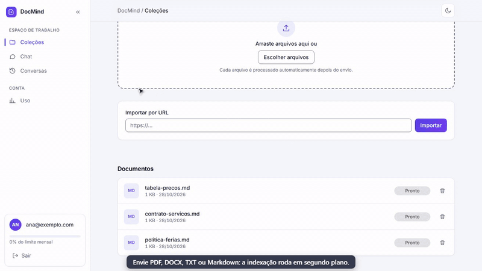
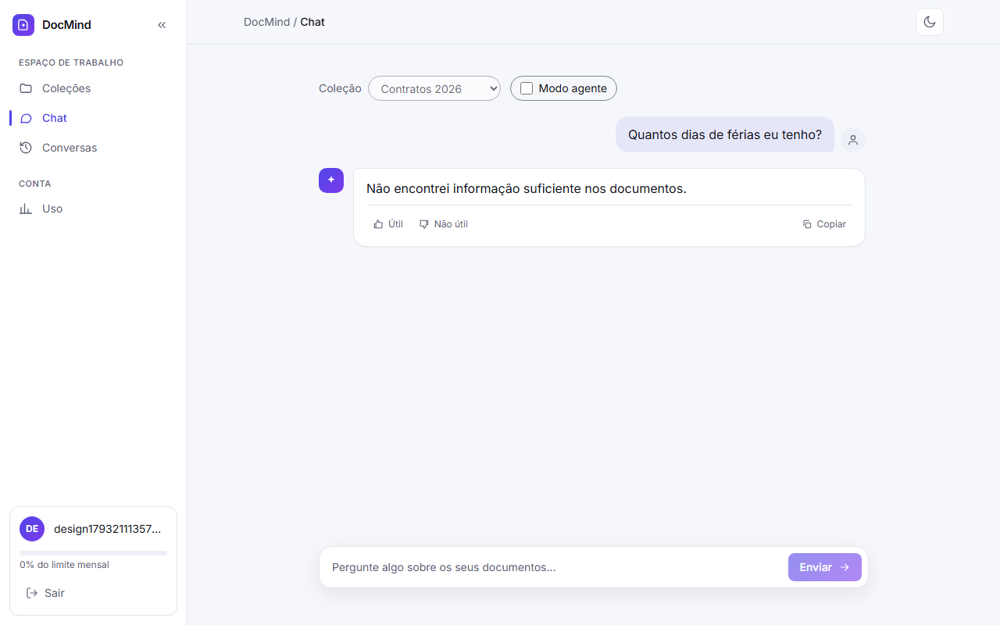
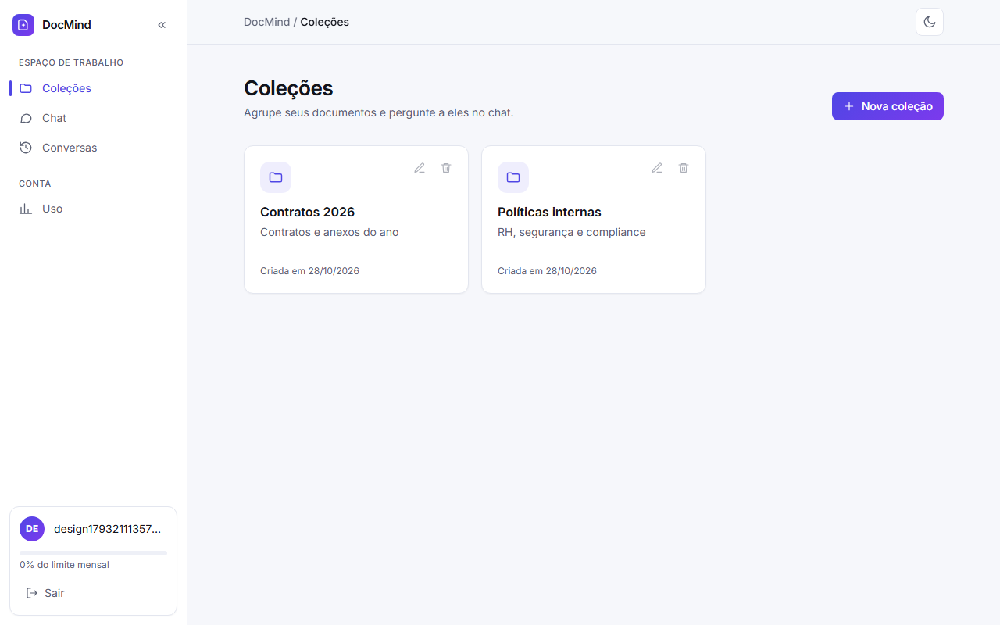
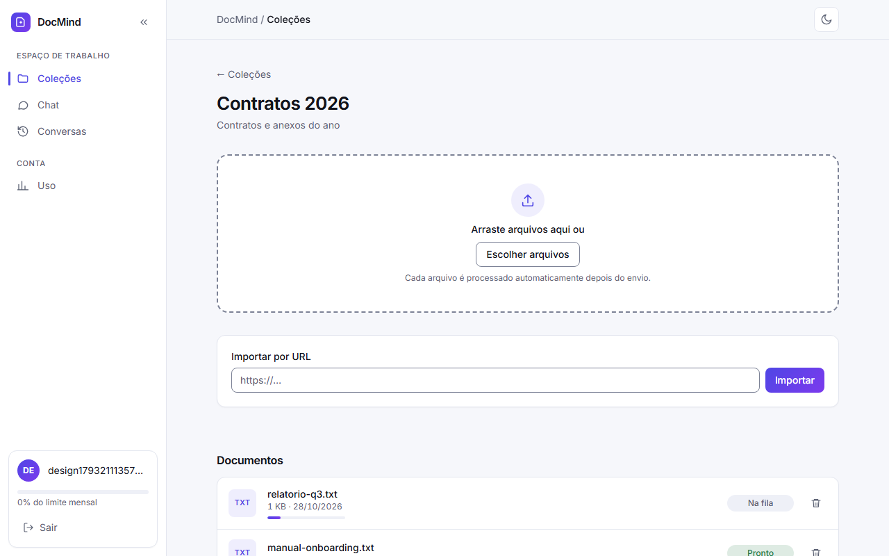
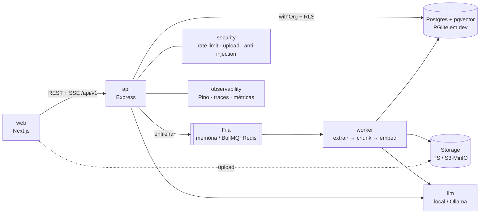

# DocMind

[](https://github.com/victorgpd/docmind-rag/actions/workflows/ci.yml)

Plataforma multi-tenant em que empresas enviam documentos (PDF, DOCX, TXT, Markdown, URL) e fazem perguntas com **resposta em streaming e citação exata da fonte** (documento + página + trecho). RAG híbrido, fila de ingestão, avaliação automática e **100% local por padrão (nenhuma API externa ou chave)**; OpenAI é um provider opcional (`LLM_PROVIDER=openai`, ver `docs/RODAR.md`).

**Demo ao vivo:** [https://docmind.nexuscrmm.com](https://docmind.nexuscrmm.com) (botão **Experimentar a demonstração**)



> **Vídeo (2 min, com legendas):** [MP4](docs/demo/docmind-2min.mp4) · [WebM](docs/demo/docmind-2min.webm) — cadastro, coleção, upload até "Pronto", pergunta com streaming e citação, paráfrase, "não encontrei" fora do corpus, modo agente extraindo tabela, histórico, uso/custo e tema escuro, gravado com a OpenAI (`pnpm --filter @docmind/tests video`, ver [docs/RODAR.md](docs/RODAR.md#gravar-o-vídeo-da-demonstração-2-min)). Versão curta (32 s): [webm](docs/demo/docmind-demo.webm). Para ver com dados: rode a API e `pnpm demo:seed`, depois entre com `demo@docmind.dev` / `demo-docmind-123` (credencial **só de desenvolvimento**).



| Coleções | Documentos e status |
|---|---|
|  |  |

## Experimente

Em produção: **[docmind.nexuscrmm.com](https://docmind.nexuscrmm.com)**. Clique em **Experimentar a demonstração** (na página inicial ou no login) para entrar, sem cadastro, numa conta somente leitura com políticas fictícias de uma empresa de exemplo e perguntar, por exemplo, "Quantos dias de férias o colaborador tem direito?". Conversas da demonstração são apagadas após 24 h; para enviar seus documentos, crie uma conta. Como habilitar: [`docs/DEPLOY.md`](docs/DEPLOY.md#conta-de-demonstração).

## Arquitetura



Detalhes e contratos entre pacotes: [`docs/ARCHITECTURE.md`](docs/ARCHITECTURE.md).

## Funcionalidades

- Cadastro/login JWT + refresh, organizações e papéis (admin, membro)
- Upload de PDF, DOCX, TXT e Markdown, e importação por URL
- Ingestão em segundo plano com status em tempo real (SSE)
- Chat em streaming com citações clicáveis e histórico por usuário
- Coleções: perguntar só dentro de um grupo de documentos
- Busca híbrida (vetor + texto completo, fusão RRF) e reranking
- Abstenção: se o melhor trecho tem relevância abaixo de `RAG_MIN_RELEVANCE`, a resposta é "não encontrei" em vez de inventar
- Modo agente (`agent: true` no chat): o sistema planeja e usa ferramentas (buscar, resumir, comparar, extrair tabela) e mostra os passos; a resposta, as citações e o payload (ex.: tabela) ficam no histórico
- Isolamento por organização com Row Level Security
- Rate limit por usuário e organização, validação de upload por magic bytes, defesa contra prompt injection
- Controle de custo: limite mensal de tokens por organização, teto global do serviço (`GLOBAL_MONTHLY_TOKEN_LIMIT`) e cadastro limitado por IP/dia ou fechado (`REGISTRATION_*`); veja "Controle de custo" em [docs/DEPLOY.md](docs/DEPLOY.md)
- Logs estruturados com id de requisição, tracing e métricas por etapa

## Métricas de avaliação

Pipeline real de ingestão e busca, juiz lexical determinístico, em duas configurações:

- **local** (`pnpm --dir evals eval`, zero API externa, é o gate de CI): embeddings lexicais (hashing + stemming) e gerador extrativo. Resultado em [`evals/results/latest.md`](evals/results/latest.md).
- **OpenAI = produção** (`--provider openai`, medido em 2026-10-28): `text-embedding-3-small` (384 dims) nos chunks e nas consultas, `gpt-4o-mini` na geração (temperatura 0 só na avaliação), mesmo `LocalReranker`. Resultado em [`evals/results/openai-latest.md`](evals/results/openai-latest.md). Custo da rodada completa: ~US$ 0,014 (8 mil tokens de embedding, 82 mil de entrada e 3 mil de saída no chat).

O número válido é o do conjunto **held-out**: 20 perguntas (18 com resposta e 2 sem) que nunca foram usadas para ajustar o sistema. O dev (69 perguntas) foi usado para ajustar e superestima.

| Conjunto | Config | recall@1 local | recall@1 OpenAI | recall@5 local | recall@5 OpenAI | abstenção local | abstenção OpenAI | falsa abstenção local | falsa abstenção OpenAI | faithfulness* local | faithfulness* OpenAI |
|---|---|---|---|---|---|---|---|---|---|---|---|
| **held-out** | sem rerank | 22% | 44% | 61% | 78% | 0% | 100% | 0% | 33% | 100% | 67–72% |
| **held-out** | com rerank | 44% | **50%** | 67% | **78%** | 0% | 100% | **44%** | **61%** | 100% | 78% |
| dev | sem rerank | 79% | 82% | 94% | 95% | 0% | 100% | 0% | 3% | 100% | 76–82% |
| dev | com rerank | 89% | 90% | 98% | 98% | 57% | 100% | 2% | 2% | 100% | 76–79% |

\* Juiz lexical (sobreposição de tokens, sem entailment): o gerador extrativo local copia o trecho e tira 100%; o gpt-4o-mini parafraseia e é penalizado, o que não equivale a alucinar. Abstenção: n=2 no held-out e n=7 no dev. Falsa abstenção = pergunta com resposta respondida com "não encontrei". Faithfulness OpenAI variou entre as 3 rodadas; o recall foi idêntico.

- Com os embeddings de produção, o recall@5 no held-out vai de 67% para 78%. A meta aspiracional de 80% **continua não atingida**. O gate de CI é um piso de regressão (recall@5 ≥ 0,60, modo local), não uma meta.
- Com OpenAI o reranking **não melhora o recall@5** no held-out (78% com e sem): sobe o recall@1 de 44% para 50%, ajuda em sinônimo/sigla e atrapalha em paráfrase e nome próprio. O reranker é lexical e foi calibrado com os embeddings locais; nada foi recalibrado.
- **Falsa abstenção no held-out com rerank: 44% local e 61% OpenAI** (39 pts pelo limiar `RAG_MIN_RELEVANCE`=0,17, que nem chama o gerador; 22 pts pelo gpt-4o-mini). O score do reranker lexical fica baixo em paráfrases e siglas inéditas. O dev não mostra o problema (só 2% de falsa abstenção), então a calibração foi feita num conjunto novo, `evals/calib/` (30 perguntas). A recomendação para a OpenAI é pesos 0,5/0,4/0,1 e limiar 0,10. Na verificação única no held-out, a falsa abstenção cai de 61% para 33% e o recall@5 sobe de 78% para 89%, com abstenção correta de 100% (n=2). Esses valores são configuração de produção (`docs/DEPLOY.md`); os defaults do código e o CI não mudaram.
- Tokens por resposta (gpt-4o-mini): ~490 de entrada e ~20 de saída, cerca de US$ 0,0001.

**Limitações:** poucas perguntas por categoria e só 2 sem resposta no held-out (sem intervalo de confiança); o juiz é lexical; a temperatura 0 é da avaliação, a produção usa o padrão da API. Detalhes em [`evals/README.md`](evals/README.md).

### Desempenho (medido localmente)

Medido nesta máquina com PGlite (Postgres em WASM) e o provider local, não com Postgres de produção nem com um LLM de verdade; serve como ordem de grandeza.

| O que | Resultado |
|---|---|
| Busca vetorial (5 mil chunks, p50) | 3 ms |
| Busca por texto | 15 ms |
| Fusão RRF e ranking | 8 ms |
| Busca híbrida completa | 29 ms |
| Pipeline completo de consulta | 32 ms (p95 43 ms) |
| Ingestão: 50 documentos pequenos | 0,43 s (116 docs/s) |

Reproduza com `pnpm --filter @docmind/retrieval bench` e `pnpm --filter @docmind/worker load`. A latência de geração com um modelo real (Ollama) não está incluída.

## Como rodar

```bash
corepack enable        # ou: npm i -g pnpm
pnpm install
cp .env.example .env   # nenhuma chave externa é necessária
pnpm dev               # api :3001, worker, web :3000
curl localhost:3001/api/v1/health
```

Sem `DATABASE_URL` o banco é PGlite (sem Docker); sem `REDIS_URL` a fila é em memória e o worker roda junto da API. Para a stack completa (Postgres + pgvector, Redis, MinIO, api, worker e web):

```bash
cp infra/.env.example infra/.env   # senhas e JWT_SECRET de dev; troque em produção
docker compose -f infra/docker-compose.yml --env-file infra/.env up --build
```

**Verificado em 28/10/2026 (Docker 29.7):** build das 3 imagens, `up -d` com todos os serviços saudáveis, `/api/v1/ready` 200 (banco e Redis), web 200 e proxy da web para a API 200, e `SMOKE_URL=http://localhost:3001 pnpm smoke` contra a stack real (Postgres + BullMQ + MinIO): 11 de 11 verificações. Não foi testado em Linux nem em CI.

Requisitos e avisos do compose:
- **pgvector ≥ 0.8** é obrigatório (a busca usa `hnsw.iterative_scan`); o compose usa `pgvector/pgvector:0.8.2-pg16`. Num Postgres próprio, instale uma versão equivalente.
- **MinIO:** usa `bitnamilegacy/minio` (imagem congelada, **só para desenvolvimento**); em produção use um S3 gerenciado.
- **Redis** tem senha (`REDIS_PASSWORD`, padrão de dev em `infra/.env.example`); `POSTGRES_PORT` e `REDIS_PORT` são configuráveis (ambos escutam só em `127.0.0.1`).
- No `pnpm install`, os scripts de build precisam estar liberados (`allowBuilds` no `pnpm-workspace.yaml`, já configurado).

Os dados de demo entram com `pnpm demo:seed` (API no ar).

Ajustes da busca (todos opcionais, no `.env`):

| Variável | Padrão | Efeito |
|---|---|---|
| `RAG_MIN_RELEVANCE` | 0,17 | abaixo disso (score do rerank no melhor trecho) a resposta é "não encontrei"; 0 desliga. Recalibre ao trocar de reranker ou de corpus |
| `RAG_W_RERANK` / `RAG_W_SIM` / `RAG_W_RRF` | 0,8 / 0,1 / 0,1 | pesos (relativos entre si) da ordenação final: rerank, similaridade vetorial, RRF |
| `RAG_TOP_K` | 6 | trechos enviados ao gerador (1 a 20) |

Qualidade: `pnpm typecheck && pnpm test && pnpm lint`.

## Decisões técnicas

- **Busca híbrida:** vetores erram nomes próprios, códigos e siglas; o texto completo acerta esses casos mas não entende sinônimos. Fundir as duas listas por RRF (só usa posição, sem calibrar scores) pega o melhor de cada. O reranker reordena o top 30 para 5–8 trechos.
- **RLS:** o isolamento entre empresas vive no banco, não em `WHERE organization_id` espalhado pelo código. Esquecer um filtro não vaza dados, porque a policy é aplicada em toda query feita via `withOrg`.
- **Fila:** extração, embeddings e gravação são lentos e falham; ficam no worker com retry, e o chat nunca espera por ingestão.
- **Tudo local por padrão:** PGlite, fila em memória, filesystem e LLM local deixam qualquer avaliador rodar sem conta nem chave; Postgres, Redis, S3 e Ollama entram por configuração.
- **LLM atrás de uma interface:** trocar de provedor não toca no resto do código.

Uso de segurança e observabilidade: [`docs/SEGURANCA-OBSERVABILIDADE.md`](docs/SEGURANCA-OBSERVABILIDADE.md).

Mais documentação: [arquitetura](docs/ARCHITECTURE.md) · [como rodar](docs/RODAR.md) · [ingestão](docs/INGESTAO.md) · [API](docs/API.md) · [convenção Express](docs/API-EXPRESS.md) · [worker](docs/WORKER.md) · [design](docs/DESIGN.md) · [decisões (ADRs)](docs/adr/) · [revisão de segurança](docs/REVISAO-SEGURANCA.md).

## Como foi construído

Projeto desenvolvido com assistência de IA: boa parte do código foi escrita com um assistente de programação, com revisão e com as decisões técnicas (contexto, decisão e consequências) registradas em [`docs/adr/`](docs/adr/). A confiança vem das verificações, não da ferramenta: lint, typecheck e testes no CI ([`ci.yml`](.github/workflows/ci.yml)), avaliação do RAG em cada pull request ([`eval.yml`](.github/workflows/eval.yml)) e revisões de segurança em [`docs/REVISAO-SEGURANCA.md`](docs/REVISAO-SEGURANCA.md).
