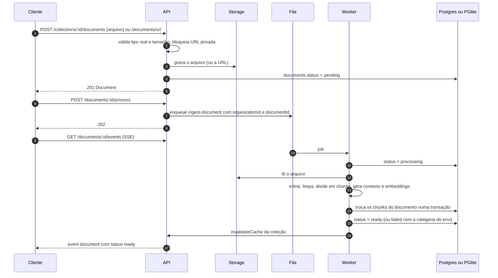
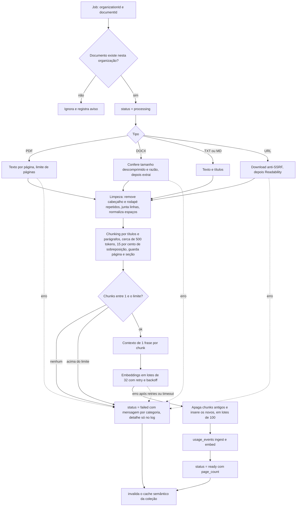

# Fluxo de ingestão

Da carga do arquivo até o documento `ready`. Código: `apps/api/src/routes/documents.ts` (entrada), `apps/worker` (fila e banco) e `packages/ingest` (extração, chunks, embeddings). Detalhes de retries, limites e erros: `docs/WORKER.md`.

## Visão geral

Sem `REDIS_URL` a fila é em memória e o worker roda dentro do processo da API. Com Redis (BullMQ) o worker é um processo separado.

## O que acontece dentro do worker

## Etapas
| Etapa | Onde | Observações |
|---|---|---|
| Extração | `packages/ingest/src/extract.ts` | PDF guarda a página de cada trecho; DOCX, TXT, MD e URL não têm página (`null`) |
| Limpeza | `clean.ts` | Cabeçalho e rodapé que se repetem em metade das páginas (mínimo 3) saem; hifenização é desfeita |
| Chunking | `chunk.ts` | Alvo de 500 tokens (estimativa de 4 caracteres por token), sobreposição de 15 por cento, página = onde o chunk começa |
| Contexto | `context.ts` | Provider `local`: frase fixa (documento, seção, página). Ollama: gerada pelo LLM, com fallback para a fixa |
| Embeddings | `index.ts` | 384 dimensões; o texto embutido é contexto mais conteúdo, mas `chunks.content` guarda o original (é ele que vira citação) |
| Gravação | `apps/worker/src/index.ts` | Reprocessar é idempotente: apaga e reinsere os chunks do documento. Colunas: `content`, `context`, `section`, `page`, `token_count`, `embedding` e `tsv` (gerada) |

Depois de gravar, a busca usa o índice HNSW (vetor) e o GIN (texto completo) da tabela `chunks`. No PGlite o worker roda `ANALYZE chunks` quando a fila esvazia, para o planejador não abandonar o HNSW.
